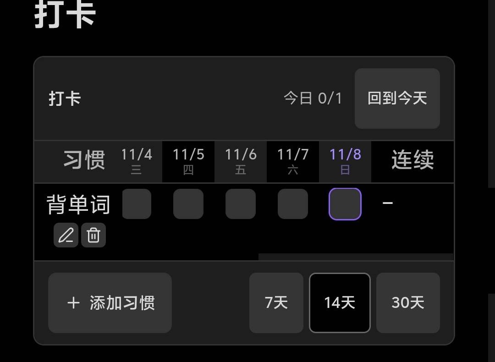

# Checkin Grid

一个把打卡表格塞进笔记正文的 Obsidian 插件。数据就是几行 markdown，格子只是它的一层可点视图——不改 `data.json`、不建索引、不锁进某个插件里。



## 为什么再做一版

已有插件大多把打卡记录存在自己的 `data.json` 里。这意味着：换插件记录就没了，git 同步时它是二进制黑箱，手机上想改一条要开电脑。

这个插件反过来：**打卡记录写在代码块里**，一行一个习惯。

```markdown
- 背单词 | 2026-11-05, 2026-11-06
- 到梦空间活动 | 2026-11-07
- 早起
```

好处很直接：

- 笔记本身就是备份，`git log` 能看到哪天打了卡；
- 手机、电脑、纯文本编辑器都能改，格式坏了也能一眼看出；
- 关掉插件，数据还在，只是不渲染成表格。

## 特性

| 能力 | 说明 |
|---|---|
| 代码块渲染 | ```` ```checkin ```` / ```` ```daka ```` / ```` ```打卡 ```` 三种写法都认 |
| 点格子打卡 | 点一下写入日期，再点一下取消，立刻写回文件 |
| 连续天数 | 右侧自动算连续打卡天数，断一天就归零 |
| 完成率 | 当前窗口内的完成百分比（窄屏自动隐藏，把宽度让给格子）|
| 7/14/30 天窗口 | 底部一键切换，选择会记住 |
| 默认定位到今天 | 打开笔记就滚到最右，今天永远在视野里；顶栏「回到今天」可随时复位 |
| 行内改名 | 点习惯名或铅笔图标就地编辑，Enter 保存、Esc 取消，重名会被拦下 |
| 行内删除 | 垃圾桶图标 → 二次确认，删的时候会告诉你有几天记录一起没了 |
| 移动端 | 格子放大到适合手指点、习惯列固定在左侧、表格不撑破页面 |

## 安装

1. 到 [Releases](https://github.com/dongyue12/obsidian-checkin-grid/releases) 下载 `main.js`、`manifest.json`、`styles.css`；
2. 放进 `<你的库>/.obsidian/plugins/checkin-grid/`；
3. 重载 Obsidian（`Ctrl+R`），在 设置 → 第三方插件 里启用 **Checkin Grid**。

文件夹名必须是 `checkin-grid`，要和 `manifest.json` 里的 `id` 一致。

## 用法

新建一条笔记，插入代码块：

````markdown
```checkin
- 背单词 | 2026-11-05, 2026-11-06
- 到梦空间活动
```
````

- 每行是 `- 习惯名 | 日期, 日期`，日期格式 `YYYY-MM-DD`，**竖线后面可以完全省略**（等于一次都没打）。
- 习惯名里的空格没问题；想加备注就写在竖线后、日期的前面不行——那里只放日期。要写说明，放在代码块外面。
- 删习惯 = 删掉那一行（或者点行内垃圾桶，更安全）。

### 界面说明

```
打卡                                    今日 2/3   回到今天
┌────────┬──────┬──────┬──────┬──────┬──────┬────┐
│ 习惯   │ 11/4 │ 11/5 │ 11/6 │ 11/7 │ 11/8 │连续│完成│
├────────┼──────┼──────┼──────┼──────┼──────┼────┤
│ 背单词 │  ▢   │  ▣   │  ▣   │  ▢   │  ▣   │ 1  │60% │
└────────┴──────┴──────┴──────┴──────┴──────┴────┘
[+ 添加习惯]                          [7天] [14天] [30天]
```

- **今日 x/y**：今天已完成 / 总习惯数，全打完会变色。
- **今天那一列**：描边高亮；未来的格子是灰的，点不动。
- **连续**：从今天（或昨天）往前数，连着打了几天。
- **完成**：当前窗口（7/14/30 天）的完成百分比。

## 和同步插件一起用

打卡数据是笔记正文，所以用 vault-sync-git / obsidian-git 时它跟普通笔记一样同步：手机上打完卡，回到电脑 `git log` 能看到改动；冲突了也是文本冲突，能手改。

建议把习惯放一条独立笔记（比如 `打卡.md`），同步时不容易和别人正在编辑的长文撞上。

## 已知限制

- 不支持「每周 N 次」这类目标，只有「打没打」。
- 日期窗口是「最近 N 天」，不支持自由翻到上个月。
- 没有提醒/通知，也没有统计图表。
- 一天只能记一次（没有次数概念）。

## 开发

无构建步骤，仓库里的 `main.js` 就是 Obsidian 直接加载的产物。

```bash
git clone git@github.com:dongyue12/obsidian-checkin-grid.git
# 复制到 <vault>/.obsidian/plugins/checkin-grid/
node --check main.js   # 语法检查
```

数据结构：

- 代码块内：`- 名称 | YYYY-MM-DD, YYYY-MM-DD`
- 插件数据（`data.json`）：只存窗口天数 `{ "days": 7 }`，不含打卡记录

## 许可

MIT，详见 [LICENSE](LICENSE)。

---

## English

Checkin Grid renders a clickable habit grid from a fenced `checkin` code block. The data lives in your note as plain lines (`- habit | 2026-11-05, 2026-11-06`), so it survives plugin removal, syncs through git like any other text, and can be edited on a phone or in any text editor.

Click a cell to check in, click again to undo. Streaks and window completion are computed on the fly. Rename or delete habits inline with hover buttons — no need to switch to source mode. The table auto-scrolls to today on open, keeps the habit column sticky on narrow screens, and offers 7 / 14 / 30 day windows.

Install: drop `main.js`, `manifest.json`, `styles.css` into `<vault>/.obsidian/plugins/checkin-grid/` and enable it. MIT licensed.
